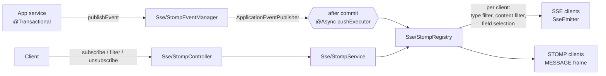

# push-manager

A Spring Boot library that adds real-time push to a web application with one annotation: clients subscribe to typed channels over **Server-Sent Events** or **STOMP over WebSocket**, filter what they receive, and the application publishes events with a single call, delivered only after the database transaction commits.

## Features

- **Two protocols, one model**: SSE (REST subscription + `text/event-stream`) and native STOMP `SUBSCRIBE` over WebSocket; STOMP is opt-in (`@EnablePushMessaging(stomp = true)`) and its dependencies are optional, so SSE-only apps don't pull them in.
- **Typed channels generated at compile time**: channels are declared on the annotation; an annotation processor generates a `Channels` enum and validates channel names at build time. Publishing a payload of the wrong type is rejected.
- **Zero-code endpoints**: extend `SseController<Channels>` or `StompController<Channels>` with an empty body to get subscribe, stream, update-filters and unsubscribe.
- **Server-side filtering per client**: by event type (`CREATED`, `UPDATED`, `DELETED`, `MESSAGE`) and by payload content, with 18 checks (equality, ranges, dates in past/future, string prefix/suffix/contains, length, null checks) on nested fields, comparing against a constant or another field. Filters are validated and compiled into predicates once, at subscription time (invalid filters → HTTP 400 or a STOMP error message).
- **Field selection (projections)**: each client can ask for a subset of fields (`address.city`, `orders.amount` across collections); events whose selected fields are all empty are not sent.
- **Filters can change while streaming** (SSE `PUT`, STOMP `SEND` with receipt).
- **Transaction-aware, asynchronous delivery**: events go out on `@TransactionalEventListener(AFTER_COMMIT)`, so a rollback sends nothing; delivery runs on a dedicated `pushExecutor` thread pool, separate from the application's executors.
- **Connection lifecycle**: SSE heartbeat to keep connections alive behind proxies, `CONNECTED`/`DISCONNECTED` events, suggested reconnect delay, automatic cleanup of dead clients; for STOMP, all subscriptions of a session are removed on disconnect.
- **Plays well with an existing STOMP setup**: the library intercepts only its own destination prefix (`/push`), never forwards push frames to the broker, leaves broker configuration to the app, and its interceptor runs after Spring Security's.
- **OpenAPI-ready**: endpoints carry Swagger annotations, and the generated channel enum shows up as allowed values.

## Architecture

The code is organised by role, each with a generic abstract base and one implementation per protocol: **controller** (HTTP/STOMP entry points), **service** (subscription, filter validation, unsubscribe), **registry** (thread-safe in-memory map of clients per channel, performs the broadcast), **event manager** (publishing API) and **event** (typed payload + event type + channel). Only the STOMP classes depend on `spring-messaging`/`spring-websocket`, an invariant checked by a test. An application service publishes an event inside its transaction; Spring hands it to the event manager after commit, on the push executor; the event manager routes it to the protocol's registry, which, for every streaming client on that channel, applies the event-type filter, the content filter and the field selection, then writes to the `SseEmitter` or sends a STOMP `MESSAGE`.



## Stack

| | Version |
|---|---|
| Java | 25 (`maven.compiler.release`) |
| Spring Boot (BOM) | 4.0.5 |
| Spring Framework (webmvc, tx, websocket, messaging) | 7.0.6 |
| Jackson | 3.1.0 (Jackson 3, `tools.jackson`) |
| Jakarta Validation API | 3.1.1 |
| Swagger annotations | 2.2.43 |
| Google AutoService | 1.1.1 (annotation processor registration) |
| Tests | JUnit Jupiter 6.0.3, Spring Boot Test, embedded Tomcat 11.0.20 |
| Build | Maven 3.9.14 (wrapper) |

## Getting started

**Prerequisites**: JDK 25 (Maven is provided by the wrapper). The host application needs Spring MVC (`spring-boot-starter-web`), a Jakarta Validation implementation and a `PlatformTransactionManager`; for STOMP, `spring-boot-starter-websocket`.

**Build** the library and install it in the local Maven repository:

```bash
./mvnw clean install
```

**Use it** in a Spring Boot application: add the `com.fcusumano.push:push-manager:0.1.0-SNAPSHOT` dependency and list the same artifact in the compiler's `annotationProcessorPaths` (it generates the channel enum). Then:

```java
@EnablePushMessaging(channelCatalog = {
        @ChannelDefinition(topic = "USERS", payloadType = UserDto.class)
})
@SpringBootApplication
public class MyApplication { /* main */ }

@RestController
@RequestMapping("/api")
public class PushEndpoint extends SseController<Channels> {} // Channels is generated

@Service
public class UserService {
    private final SseEventManager events;
    public UserService(SseEventManager events) { this.events = events; }

    @Transactional
    public UserDto create(UserDto user) {
        // ... save
        events.publishEvent(SsePushEvent.of(user, EventType.CREATED, Channels.USERS));
        return user;
    }
}
```

**Subscribe and stream** from a client:

```bash
# 1. Subscribe to the USERS channel: only CREATED events for users in CITY-1, only id and name
curl -X POST http://localhost:8080/api/sse/subscribe/USERS \
     -H 'Content-Type: application/json' \
     -d '{"requiredEventTypes":["CREATED"],
          "contentFilters":[{"fieldPath":"address.city","check":"SAME_VALUE","value":"CITY-1"}],
          "requiredFieldsPath":["id","name"]}'
# -> {"sessionId":"<id>","channel":"USERS","streamedObject":"UserDto"}

# 2. Open the stream
curl -N http://localhost:8080/api/sse/stream/<id>
# event:CONNECTED
# data:Connection opened
# event:CREATED
# data:{"id":1,"name":"FOO-1"}

# 3. Unsubscribe
curl -X DELETE http://localhost:8080/api/sse/unsubscribe/<id>
```

With `stomp = true` and an empty `StompController<Channels>` subclass, a STOMP client (e.g. `@stomp/stompjs`) connects to `/push-ws` and subscribes to `/push/USERS`, passing the same filter JSON in a `filters` header.

## Testing

```bash
./mvnw clean verify
```

Runs 113 JUnit tests and builds the jar, sources jar and Javadoc. Coverage includes:

- **End-to-end flows on a real embedded server**: SSE (subscribe, stream, publish in a transaction, field selection, 400/404 errors) and STOMP over a real WebSocket client (filters, receipts, multiple projections per session, disconnect cleanup, push frames never reaching the broker).
- **Coexistence and isolation**: STOMP alongside an application's own broker and endpoints, SSE and STOMP events never crossing, STOMP activation/misconfiguration failing fast at startup, and a check that only STOMP classes reference the messaging APIs.
- **Unit tests**: filter validation and predicates, field selection, STOMP registry/service/controller, destination parsing, mappers, executor and scheduler wiring.

---

Built with AI-assisted development (Claude Code); design, architecture and code review by me.
